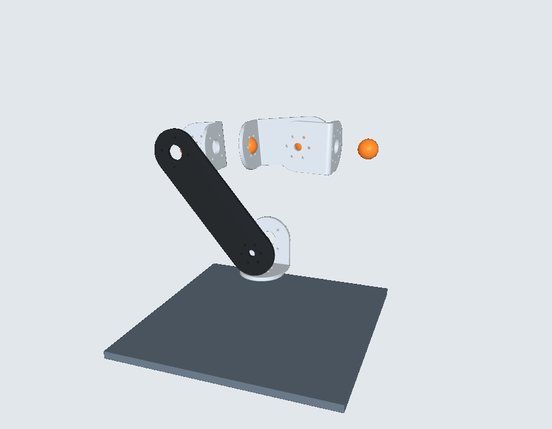
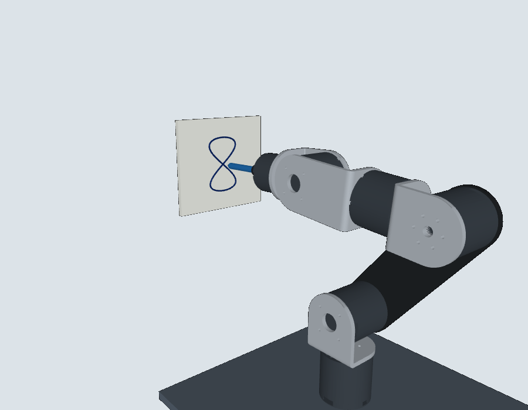
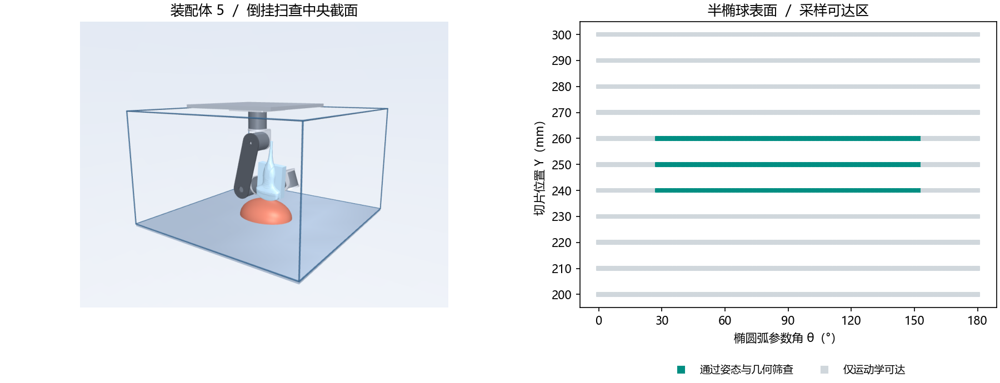

# 装配体 4 · 六轴机械臂正运动学

`arm4.xml` 是由 STEP 装配姿态建立的 MuJoCo 六转动关节模型。`arm4_fk.py` 输出 J6 法兰中心的位置、欧拉角、四元数和齐次变换，并用独立的旋转矩阵计算核对 MuJoCo 的结果。

## 运行

在 Python 3.10 环境下，从仓库根目录执行：

```sh
python -m pip install mujoco==3.1.6 numpy scipy
python arm4_fk.py
python arm4_fk.py 30 -20 35 10 -15 45
```

六个输入依次为 J1 至 J6 相对 STEP 保存姿态的角度，单位为度，正方向按 XML 中各关节轴的右手定则。省略参数使用全零姿态。

## 坐标与核对值

基坐标系原点为底板上表面中心，坐标轴与 STEP 装配坐标系平行，+Z 向上。末端为 3507 输出侧端面中心，+Z 沿输出轴向外，+X 取电机 CAD 局部 +X。RPY 的旋转矩阵为 Rz(yaw) Ry(pitch) Rx(roll)，四元数顺序为 (w,x,y,z)。

| 关节角（度） | 法兰位置 XYZ（mm） | RPY（度） |
|---|---|---|
| 0, 0, 0, 0, 0, 0 | 0.00, −134.62, 241.94 | 91.516, 0, 0 |
| 30, −20, 35, 10, −15, 45 | 16.84, 25.30, 398.14 | 11.744, 18.358, −82.724 |

模型使用简化连杆，适用于法兰位姿计算。实机关节限位、编码器零点、质量惯量、驱动参数和碰撞外形尚未标定。

## 六轴达妙 CAN 调试

`dm_debug.py` 是独立的 Python 3.10+ 命令行工具。J1～J3 为 4340、J4～J5 为 4310、J6 为 3507，编码量程从每台驱动器读取。默认电机 ID 为 0x01～0x06，反馈 Master ID 为 0x11～0x16；用达妙上位机逐台配置为唯一 ID，也可用 `--ids` 和 `--masters` 分别传六个逗号分隔的 ID。使用经典 CAN 标准帧，并保证只有一个程序控制总线。

Windows 达妙 U2CAN 串口版请安装 pyserial，将 COM5 改成实际端口。串口默认 921600，可用 `--baud` 更改；CAN 侧波特率由转接器和驱动器预先配成一致。原生 CAN 使用 python-can，例如 Linux 下已配置的 can0 使用 `--interface socketcan --channel can0`，Windows PEAK 使用 `--interface pcan --channel PCAN_USBBUS1`（需厂商驱动）。

```sh
python -m pip install pyserial
python dm_debug.py --channel COM5 monitor --once
python dm_debug.py --channel COM5 monitor
python dm_debug.py --channel COM5 jog 6 2
python dm_debug.py --channel COM5 move6 1 -1 1 0 0 2
```

monitor 只读，显示位置、速度、估算扭矩、状态码和两路温度，0 表示失能、1 表示使能。运动命令要求所选轴均处于 MIT 模式且失能无故障，以电机当前角度为起点，各轴增量不超过 ±5°。六轴按同一插值进度逐帧发送，受总线延迟影响。每次结束或异常时，程序尝试失能本次接管的电机并读取状态确认。输出的目标和实测角度用于判断跟踪情况。

首次点动请支撑肩肘和末端，确认运动方向与机械限位，并在驱动器预设通信超时保护。低增益点动没有重力补偿，失能后电机会释放；物理断线时软件无法保证失能帧送达。总线角度与 MuJoCo 零点需另行标定。协议依据见[达妙官方 U2CAN Python 例程](https://github.com/dmBots/motor-sdk/tree/main/Python例程/u2can)。

无硬件回归测试：`python -m unittest -v test_dm_debug`。测试覆盖模拟六轴点动及控制帧发送失败后的失能清理。

## 装配体 4 的 CAN / MuJoCo 运动学孪生

`arm4_twin.py` 在同一个进程中读取六轴反馈、计算法兰位姿并更新 MuJoCo 三维视图。默认硬件模式只读。输出 XYZ 单位为 mm，RPY 单位为度，坐标系见上文。无硬件可直接运行：

```sh
python arm4_twin.py --demo
python arm4_twin.py --demo --headless --frames 10
```

实机先运行六轴 monitor 读数，将机械臂置于 STEP 保存姿态，记录六个电机角度作为 `--zero-deg`，逐轴核对编码器方向后设置 `--signs`。换算关系为 `模型角 = 方向 × (实测角 − 零位读数)`。示例中的六个零和正号须替换为标定值：

```sh
python arm4_twin.py --channel COM5 --zero-deg 0 0 0 0 0 0 --signs 1 1 1 1 1 1
```

在这条命令末尾追加 `--jog 6 2` 可进行 J6 点动并同步显示，或追加 `--move6 1 -1 1 0 0 2` 联动。增量沿用调试工具的**电机原生角度方向**。调试和孪生共用一个 CAN 连接，运行前关闭其他占用转接器的程序。动作结束后程序失能所控制的轴，首次点动须支撑机械臂。退出查看器会终止本次点动。六轴反馈按序采集，任一轴反馈超时或报错即停止更新。

模型显示简化连杆、法兰位置与方向。当前实现用于运动学跟随，不估算碰撞力、负载能力或驱动动态。通过 `python -m unittest -v test_dm_debug test_arm4_twin` 运行离线联调测试。

### 装配体 4 结构件材料

四件直角支架采用 STEP 零件名中的 5052 铝合金；肩肘间长臂板采用碳纤维复合板。MuJoCo 使用装配实体的三角网格显示这五件零件，并按 CAD 实体体积、质心和惯性张量设置所在连杆的惯性参数。按均匀材料估算，5052 取 2.68 g/cm³，碳纤维板暂取 1.60 g/cm³；有板材供应商数据或实测质量时可校正。

| 构件 | 所在连杆 | CAD 体积（cm³） | 估算质量（g） |
|---|---|---:|---:|
| 直角1 | J1–J2 | 31.077 | 83.3 |
| 长臂板 | J2–J3 | 59.810 | 95.7 |
| 直角2 | J3–J4 | 30.893 | 82.8 |
| 直角3 | J4–J5 | 41.093 | 110.1 |
| 直角4 | J5–J6 | 29.532 | 79.1 |

五件合计约 451.1 g。上述惯性只计这五个结构件；整臂重力矩还需加入电机、紧固件、线束及末端工具。底板独立于碳纤维长臂板。电机外形来自装配体 4 的 STEP，J1～J3 使用 4340，J4～J5 使用 4310，J6 使用 3507。机壳附于上一级连杆，输出端按 CAD 前端几何近似分件并随关节旋转。电机网格用于显示，质量、驱动与碰撞参数待标定。



## Windows 双击启动

启动器固定使用仓库目录内的 `.venv\Scripts\python.exe`。在新电脑上，从仓库目录用 Windows 64 位 Python 3.10 一次性安装：

```powershell
py -3.10 -m venv .venv
.\.venv\Scripts\python.exe -m pip install mujoco==3.1.6 numpy==1.26.4 scipy==1.13.1 pyserial==3.5
```

安装后双击 **启动机械臂孪生.cmd** 打开操作面板和三维视图。

### 操作面板

双击启动器进入离线仿真。拖动 J1～J6 滑块或勾选“播放仿真演示”，面板显示模型角度和法兰 XYZ、RPY。关闭三维窗口后可在面板中重新打开。

硬件跟随使用同一个三维视图。选择接口及端口，核对通信速率、命令和反馈 ID，输入 STEP 保存姿态下的六个编码器角度及各轴方向，再点“连接硬件跟随”。U2CAN 使用串口波特率，PCAN / SocketCAN 使用 CAN 位速率。后两种接口还需在项目环境安装 python-can，并配置相应驱动。收到六轴有效反馈后才显示已连接。硬件模式只读，读取超时或驱动器报错会冻结显示。点“断开并切回仿真”释放连接，恢复离线滑块。带参数的启动器调用仍转发给原有命令行工具。

### 写字演示

在操作面板点击 **仿真写 8**。模型从 STEP 零位开始，用 J6 法兰上的 80 mm 笔依次接近写字板、落笔、画出约 42 × 72 mm 的数字 8，再抬笔 12 mm。笔迹由 MuJoCo 正运动学得到的笔尖坐标绘制。此按钮仅在仿真模式可用。



## 装配体 5 · 倒挂超声扫查（默认操作面板）

双击 Windows 启动器，选定橙色断面和左右弧范围，点击 **扫描橙色线**。每段从已求解的起点单独播放。面板显示 C5-2-R60 工作面中心在盒坐标系的位置和姿态。此按钮仅执行几何仿真。旧写字场景可通过 `.\.venv\Scripts\python.exe arm4_panel.py --writing` 打开。

俯视时 X 向右、Y 向上，Z 自盒底向上。盒内尺寸 500 × 500 × 300 mm，基座位于顶面左上区域，安装中心 (160,340,300) mm。装配体 5 的六轴安装位置沿用相同装配姿态；探头外形、相对 J6 的位置来自新增的 Sonosray CAD 零件。取探头局部 +Y 为中央声束，TCP 为该轴与前端曲面的交点，该声学坐标系尚待实测标定。

半椭球平底中心 (250,250,0) mm，半轴 (80,60,50) mm。扫描平面平行 XZ；探头中央切面的法线（声束）保持在切片内，沿该截面椭圆的内法线，长阵列轴沿截面切向。允许沿声束翻转 180°。弧参数角 0° 为 +X 侧底缘，90° 是该截面最高点，180° 是 −X 侧底缘。

### 如何复算

运行 `python arm5_scan.py` 重新生成点位和连续段；运行 `python -m unittest test_arm5_scan` 回读并验证播放文件。使用球腕解析逆解枚举肩、肘、腕分支。模型肩到肘、肘到腕心各 160 mm，腕心到探头 TCP 为 105.64 mm。理想无限位 TCP 距肩中心 (160,340,193.5) mm 可为 0～425.64 mm，带指定姿态时应先把目标 TCP 减去姿态旋转后的腕心至 TCP 偏置，再判断腕心到肩中心是否在 0～320 mm。

- `arm5_scan.csv` 包含 11 个切片（Y=200～300 mm，间隔 10 mm）、每片 91 个采样点（间隔 2°）。1001 点有姿态逆解，其中 189 点通过模型几何筛查。这个计数不是面积覆盖率。
- `arm5_passes.csv` 给出 738 个以 0.5° 加密验证的姿态，分为 6 段。Y=240、250、260 mm 均为 28～122°、124～152°。各段的分界对应本次分支选择。
- 按刚性零件凸包检查盒内边界、与半椭球的几何干涉及非相邻连杆间距；探头与目标的离散几何容差约 0.5 mm。箱壁按内表面计，实际机械限位、线束、软组织变形、接触力及声学成像未建模。结论适用于采样点，连续物理行程还需验证。




### 按盒坐标选择断面

在“盒坐标系 · 等距断面”中选择 XZ 或 YZ。XZ 固定 Y，YZ 固定 X，初始位置均为 250 mm。选择 1、2、5 或 10 mm 间距，然后用“上一面”和“下一面”沿固定坐标轴减小或增大位置。橙色曲线标记选中的断面。拖动断面坐标旁的滑条可以连续移动整条橙线。每次仅扫描当前橙线上的可达弧段。


### 从指定 XYZ 开始扫查

选择 XZ 或 YZ，输入盒坐标 XYZ（mm），点“贴合起点”。程序保留切面位置，在该截面的归一化椭圆内径向投影，绿色点为贴合结果。左弧朝截面水平坐标减小方向，右弧朝增大方向（XZ 用 X，YZ 用 Y）。角度是椭圆参数角，0° 范围关闭该侧。点击“扫描橙色线”执行。离散段之间做限速仿真转位。基座原点在安装面中心，BX、BY、BZ 分别对应盒坐标的 −X、+Y、−Z，面板同时显示探头的基座坐标。

新安装位置下，中央 XZ 面的底缘姿态会让探头壳低于盒底 40 mm，26° 时仍低于盒底 2.43 mm。仅平移基座不能覆盖整条弧。文中场景插图为移动前的安装位置。


“扫查操作”页的“← 起点”和“起点 →”按所选毫米步长沿当前截面的水平坐标移动，滑条支持连续调节。高度随截面轮廓更新。上一面和下一面沿垂直于当前切面的方向等距移动，并保留起点的椭圆参数角。XZ 与 YZ 分别记忆断面位置和起点角度。盒体用线框显示，盒底仍为几何筛查边界。

求解在后台执行。仿真播放对关节角解卷绕，再作保形三次插值。各段首尾速度为零。J1 至 J6 的仿真速度上限依次为 24、18、22、32、38、42 °/s，加速度上限为 60、45、55、80、95、105 °/s²。按速度与加速度上界放慢整段，转位期间关闭扫查轨迹。碰撞校核针对求解采样点，段间转位和插值路径未经连续避障验证。
